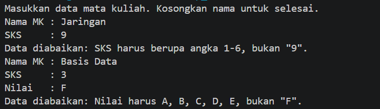

# Kalkulator IP Semester (Console)

Tugas Rutin 3 - Pemrograman Mobile (3KOM40215)

## Identitas
- **Nama:** Sebastian Saut Marulitua Sinaga
- **NIM:** 4242550005
- **Kelas:** PSIK 24D

## Deskripsi
Program console Dart untuk menghitung IP satu semester dan mencetak KHS.
Data mata kuliah dimasukkan satu per satu sampai nama dikosongkan.

## Cara Menjalankan
```bash
dart run bin/ip_semester.dart
```

## Tangkapan Layar Satu Sesi (memuat input salah)


## Penjelasan
Higher-order function saya pakai di beberapa fungsi. Di `totalSks` dan
`hitungIp`, saya memakai `fold` untuk menjumlahkan SKS dan total SKS × bobot,
lalu IP didapat dari pembagian keduanya. Di `mkPerluDiperbaiki`, `where`
menyaring mata kuliah yang bobotnya kurang dari 2, lalu `map` mengambil
namanya saja. Di `cetakKhs`, `sort` menerima fungsi pembanding yang
membandingkan bobot nilai sehingga KHS tampil dari nilai tertinggi. Fungsi-
fungsi itu menerima fungsi lain sebagai argumen, sehingga logikanya singkat
dan tidak perlu perulangan manual.

Error handling saya terapkan pada `validasiSks` dan `validasiNilai`. Keduanya
melempar `FormatException` ketika SKS bukan angka 1-6 atau nilai bukan A-E.
Exception ditangkap dengan `try` dan `on FormatException catch` di `main`,
sehingga data yang salah hanya diabaikan dan pesannya ditampilkan, sedangkan
program tetap berjalan dan pengguna bisa memasukkan data berikutnya.

## Pernyataan Penggunaan AI
Saya menggunakan AI sebagai asisten belajar pada tugas ini,
untuk membaca spesifikasi tugas, menyusun kerangka dan contoh kode program,
serta memahami perbedaan hasil perhitungan IP. Kode saya jalankan sendiri di
VS Code, saya uji dengan berbagai input (termasuk input salah), dan saya
periksa dengan `dart analyze`. Dari proses ini saya belajar menggunakan
`fold`, `where`, dan `sort` dengan fungsi pembanding, serta menangkap
exception di `main` agar program tidak berhenti.